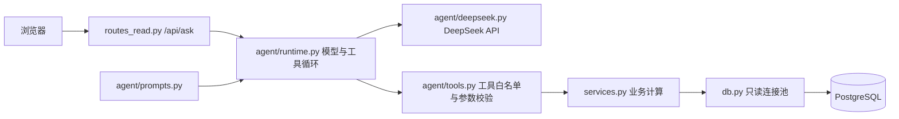
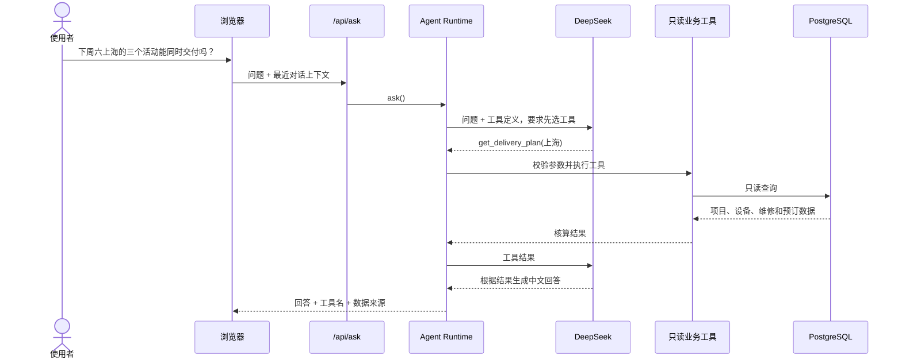

# DeepSeek Agent 代码 Review 入口

## 模块怎么分

模型决定调用哪些工具、传什么参数以及如何组织最终回答。工具注册表限制了它能做的事；库存、时间冲突和成本计算仍由确定性的 Python 业务代码完成。预订写入不在 Agent 工具表中，仍需页面预览和人工确认。

## 一次提问怎么走

## Review 时看这几处

| 问题 | 代码位置 |
| --- | --- |
| 模型 Key 和 HTTP 请求怎样处理？ | `agent/deepseek.py`、`config.py` |
| 模型能调用哪些工具？ | `agent/tools.py` 的 `TOOL_SPECS` 与 `execute()` |
| 工具调用如何循环、限制轮次？ | `agent/runtime.py` 的 `ask()` |
| 业务数字从哪里来？ | `services.py` 与 `db.py` |
| API 怎样返回错误、记录工具调用？ | `routes_read.py` |

Key 只从本机环境变量或被 Git 忽略的路径文件读取。Agent API 默认没有规则回答兜底：DeepSeek 不可用时会明确返回错误。短期对话上下文由浏览器提交，最多 6 条；没有数据库中的长期记忆。当前没有文档库，因此没有 RAG 模块。
