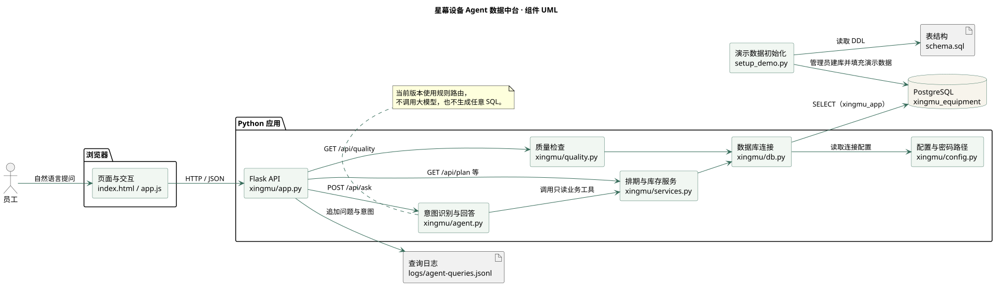
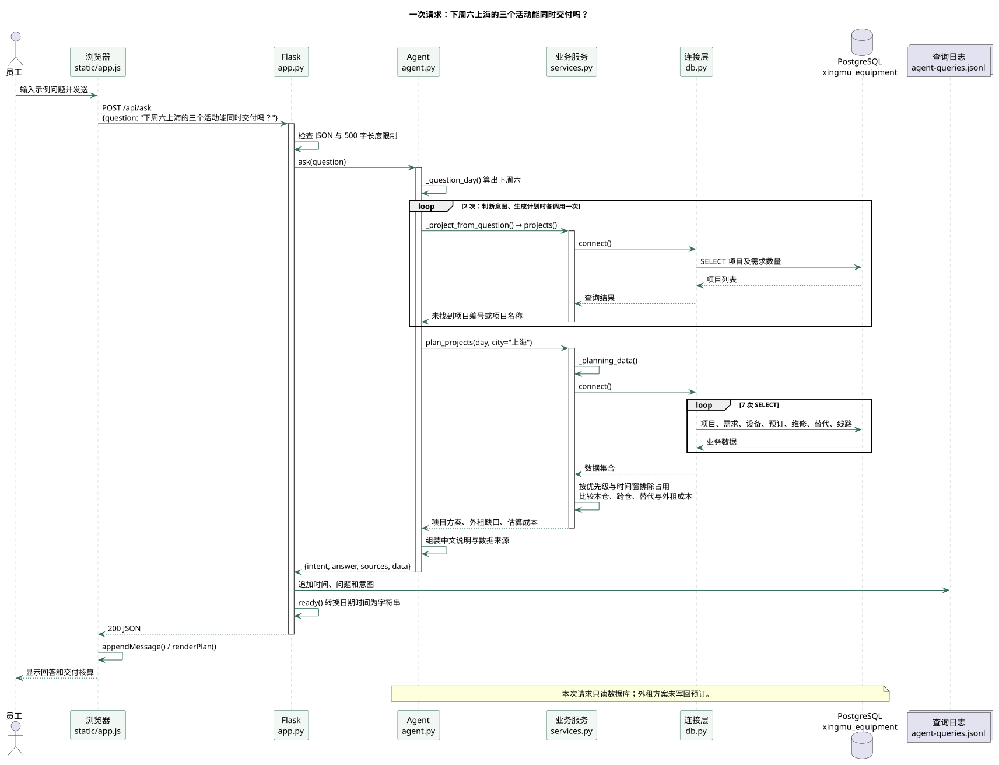

# 星幕设备项目：代码 Review 图

这两张图记录最初的只读 Agent 请求，示例问题为：“下周六上海的三个活动能同时交付吗？”。当前代码已拆分 HTTP 路由并加入会话校验、预订和并发保护。当前预订请求时序及模块对应关系见 `security-and-concurrency.md`。下图只帮助理解 Agent 查询链路。

## 1. 组件 UML

源文件：[component-uml.puml](component-uml.puml)。图展示浏览器、Flask、Agent、业务服务、只读数据库连接，以及演示数据初始化脚本的边界。

## 2. 一次请求的时序图

源文件：[request-sequence.puml](request-sequence.puml)。时序从 `static/app.js` 的 `ask()` 开始，经过 `POST /api/ask`，最终回到页面的 `appendMessage()` 和 `renderPlan()`。

## 对照代码

| Review 点 | 代码位置 |
| --- | --- |
| 网页发送请求与显示结果 | `static/app.js:47` 的 `ask()` |
| HTTP 校验、调用 Agent、写日志、序列化响应 | `xingmu/security.py`、`xingmu/routes_read.py`、`xingmu/jsonutil.py` |
| 日期解析、意图路由、中文回答 | `xingmu/agent.py:129` 的 `ask()`、`:58` 的 `_answer_plan()` |
| 查询业务数据、设备分配与成本估算 | `xingmu/services.py:90` 的 `_planning_data()`、`:127` 的 `plan_projects()` |
| 只读数据库连接 | `xingmu/db.py` 的 `connect()` |
| 表结构和关联 | `schema.sql` |

## 值得讨论的实现点

1. 这个示例请求没有项目名称或编号，`_project_from_question()` 仍会查项目列表；目前在意图判断和生成计划时各查一次，可缓存解析结果。
2. `_planning_data()` 在一次连接中执行 7 次 `SELECT`，然后在 Python 内存中按优先级和单件增量成本贪心分配。它不保证全局最低成本。
3. 网页 Agent 查询使用只读账号 `xingmu_app`；预订确认走 `routes_booking.py` 和单独的 `xingmu_booking` 账号。`POST /api/ask` 本身不写预订或采购记录。
