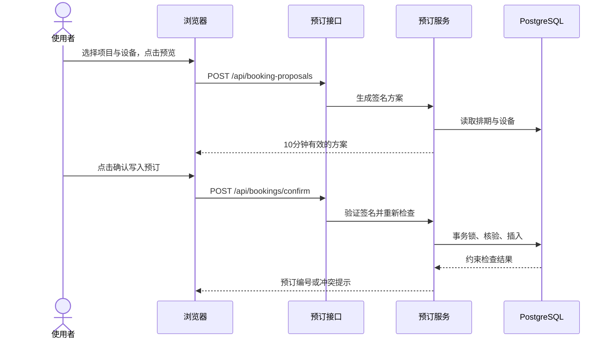

# 星幕设备：已实现的安全与并发策略

## 用直白的话说

网页只给这台电脑访问。Agent 查数据时只能使用预先写好的查询工具和只读数据库账号。预订设备先看方案，再由人点击确认；确认那一刻重新查设备是否还能用。多个请求撞在一起时，程序先按需求和设备排队，数据库再检查同一台设备的时间是否重叠。重复点击同一次确认只返回原来的预订。服务、数据库连接和请求频率都有上限。

当前没有账号密码登录。打开网页会自动建立用于防止其他网页代发写请求的会话校验；它**不代表员工身份**，也不能区分不同员工的数据权限。项目是虚构数据，网页只监听本机地址。接入真实多人业务时，需要企业统一身份和按项目的数据权限。

Agent 提问会把用户的问题和选中的虚构业务数据发送给 DeepSeek API。其他看板查询和人工预订仍在本机处理。真实企业数据接入前应完成数据分类、外部模型使用审批与脱敏。

## 代码模块

| 文件 | 做什么 |
| --- | --- |
| `xingmu/app.py` | 装配 Flask 路由和忙碌时的响应 |
| `xingmu/server.py` | Waitress 本机服务、线程和连接上限 |
| `xingmu/routes_read.py` | 只读业务 API 与 Agent 提问 API |
| `xingmu/routes_booking.py` | 预订预览与确认 API |
| `xingmu/security.py` | CSRF、来源检查、限流、安全日志和响应头 |
| `xingmu/booking.py` | 签名方案、再次核验、事务写入、幂等 |
| `xingmu/db.py` | 独立读写连接池和超时 |
| `schema.sql` | 唯一请求号与设备占用时间排斥约束 |
| `migrate_security.py` | 数据库角色、权限和本机密钥迁移 |

## 一次预订

## 验证

`python -m unittest discover -s tests -v` 的 14 项测试覆盖模型工具调用、未查库回答与未授权工具被拒绝、无 Key 时不会退回规则回答，以及只读账号、会话校验、并发预订和限流。测试结束会删除自己插入的预订和审计行。实测压力结果见 `concurrency-test-report.md`。

## 当前边界

- 会话校验用于防止跨站代发请求，不能代替登录或人员权限。
- 限流是单进程内存实现；多实例部署需改用共享限流服务。
- 当前没有说明书或合同库，因此不引入 RAG。若以后纳入文档，应先处理版本、来源和可见范围。
- 这是本机演示环境。真正企业上线还需要统一身份、密钥管理、集中审计、备份恢复演练和正式并发容量测试。
